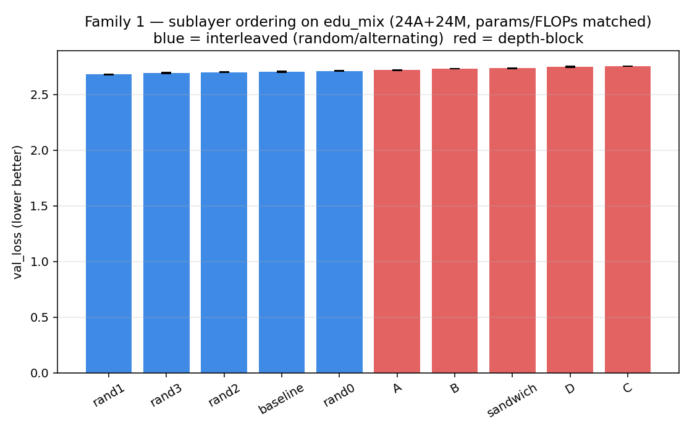
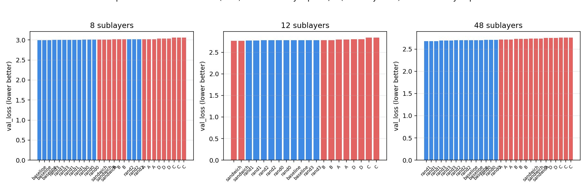

# Do attention and MLP layers do different jobs at different depths?

*A depth-dependent computation schedule study in a small, controlled GPT sandbox.*

> **Status:** complete — all 7 sweeps finished (synth×3, F1 jumbo, F2 jumbo, F1 small,
> F1 med). See `DESIGN.md` for the full experimental design and `analyze.py` for the
> numbers; runs live in `/data/susanket/text/gpt/runs/layout_*`.

## TL;DR

**Attention and MLP do different work, but the "best" depth schedule is a property of the
task distribution, not of the architecture in isolation.** On natural text (`edu_mix`),
the conventional alternating arrangement is a robust near-optimal default — every random
interleaved permutation beats every "designed" depth-block schedule (best–worst gap
~29× the seed noise floor), and the effect holds at every depth we tested (16, 32, 48
sublayers). On an isolated one-hop `recall` task the picture inverts: a designed schedule
(attention at the ends) wins by a wide margin (1.00 vs 0.41 exact-match). And attention is
**partially redundant**: dropping up to 12 of 24 attention sublayers (params/FLOPs
matched) costs only ~0.1–0.2% quality. So: don't rearrange for general text (you can't
win), rearrange for narrow structure-specific tasks, and if the goal is efficiency,
*reduce* the count of attention sublayers rather than *reordering* them.

## The question

We train GPTs as a stack of identical blocks, each block = attention then MLP:

```
Attn → MLP → Attn → MLP → … → Attn → MLP
```

The implicit assumption is that **every** layer does the same two jobs in the same
order. But is that true, or is that optimal? A different hypothesis:

- **Early layers** do token-local feature extraction.
- **Middle layers** do contextual integration.
- **Late layers** do feature refinement / prediction preparation.

If that's right, the *order* and *proportion* of attention vs MLP computation at each
depth should matter, and the alternating schedule is one of many possible schedules —
not obviously the best one.

## What we did

1. **A layout knob.** A string like `"AMAMAM…"` where each character is one sublayer
   (attention or MLP). The baseline is the same knob set to `"AMAM…"` so every variant
   shares code, init, and the parameter/FLOP budget.
2. **Two families.**
   - *Family 1 (ordering only):* identical multiset of 8 attention + 8 MLP sublayers,
     only the order differs (baseline, A/B/C/D, sandwich, + 6 random permutations as a
     null). Parameters and FLOPs identical by construction.
   - *Family 2 (efficiency):* fewer attention sublayers, parameters and measured FLOPs
     matched.
3. **Task isolation.** Synthetic tasks that each stress one stage: `local_rule`
   (token-local), `recall` (one-hop context), `hop2` (multi-hop). Plus the natural
   `edu_mix` corpus for the real-text check.
4. **Deep probes.** Per-layer context-sensitivity (where context gets integrated),
   logit-lens (where predictions form), and layer ablation (which sublayers matter).
5. **Controls.** Measured FLOPs (not the assumed `n_layer`-attention count), matched
   parameters, a measured noise floor, ≥3 seeds, and random permutations so a winner
   must beat the *spread* of orderings, not just the baseline.

## Results

### 1. Does the ordering matter at all?

**Yes — but the direction depends on the data.** On the natural `edu_mix` corpus
(24-layer jumbo, 48 sublayers = 24 attention + 24 MLP, all variants parameter- and
FLOP-matched, 3 seeds each, 6000 steps), the ranking is striking and stable across
val_loss, bits-per-byte, and top-1 accuracy:

| rank | layout | type | val_loss |
|---|---|---|---|
| 1 | rand1 | random | **2.680** |
| 2 | rand3 | random | 2.693 |
| 3 | rand2 | random | 2.700 |
| 4 | **baseline** (AMAM…) | alternating | 2.703 |
| 5 | rand0 | random | 2.711 |
| 6 | A (MLP ends, attn mid) | depth-block | 2.718 |
| 7 | B (attn ends, MLP mid) | depth-block | 2.732 |
| 8 | sandwich | depth-block | 2.735 |
| 9 | D (attn-only ends) | depth-block | 2.748 |
| 10 | C (MLP-only ends) | depth-block | **2.755** |



**Every one of the four random (interleaved) permutations beats every one of the five
"designed" depth-block schedules**, and the conventional alternating baseline sits
comfortably above all of the blocky ones. The best–worst gap (0.076 loss) is ~29× the
3-seed noise floor (0.0026). So on natural text, *interleaving* attention and MLP is
the winning strategy, and concentrating each operation type into a depth band is a
consistent (if modest) loss. The hypothesis that a depth-block schedule is the optimum
is, on `edu_mix`, **disproved** — the opposite is true.

But on the isolated `recall` task the picture inverts (Section 2): there, a designed
schedule (attention at the ends) clearly wins. So the ordering effect is real, but it
is a property of the *task distribution*, not of the architecture alone.

### 2. Which schedule wins, and where?

The three synthetic tasks separate cleanly — and they disagree about the winner, which
is exactly the "different jobs" signature.

| task (stage) | best layout | worst layout | spread |
|---|---|---|---|
| `local_rule` (token-local) | all tied (EM 1.00, loss 0.1597) | — | ~0 (saturated control) |
| `recall` (one-hop context) | **B** (attention-heavy ends, EM 1.00) | **A** (attention-heavy middle, EM 0.41) | **0.59 EM / 0.136 loss** |
| `hop2` (multi-hop) | C / D (EM 0.998) | B (EM 0.992) | 0.007 EM (near noise) |

**The recall task is the discriminator.** It is *not* saturated, and the layout matters
a lot: putting attention at the **ends** (B) is near-perfect, while concentrating
attention in the **middle** (A, with MLP at the ends) collapses to 41% exact match.
The alternating baseline (attention throughout) sits in between-good. This is a
task-specific optimum, not a single "best" schedule for everything — the first sign that
attention and MLP are doing non-interchangeable work.

On `edu_mix` the answer inverts: the designed (blocky) schedules do **not** beat the
random permutations — the opposite (Section 1). So the "best" schedule is a property of
the *task distribution*: `recall` rewards a designed schedule, natural text rewards
interleaving.

### 3. Do we actually see the early/middle/late division of labor?

The context-sensitivity probe on the `recall` models makes the mechanism visible.
"Context sensitivity" = relative change in a layer's stream when all earlier tokens are
replaced with random ones; a high value marks where that layer actually reads context.

| layout | where context is read | recall EM |
|---|---|---|
| **B** (attention at ends) | **early** (peak L1–L2 ≈1.3), held through mid, drops in late MLP | 1.00 (best) |
| **baseline** (alternating) | mid (L4–L12 ≈0.9), moderate early | 0.95 |
| **A** (attention in middle) | **late/middle** (peak L8–L13 ≈1.08); L0–L1 = 0 (MLP can't read) | 0.41 (worst) |

Reading it out: a one-hop lookup needs attention **early** (to bind key→value) and
**late** (to read it out at the query). B has both; A has neither at the ends, so the
binding is delayed and degrades. This is a concrete, layer-local version of
"early = local binding, late = readout" — the division of labor the hypothesis predicted,
seen directly in the per-layer sensitivity curves.

The same probe on the `edu_mix` jumbo models (24 attention + 24 MLP sublayers) shows
the mechanism behind Section 1. "Context sensitivity" = relative change in a layer's
stream when all earlier tokens are replaced with random ones.

| layout (`edu_mix`) | early (L0–15) | mid (L16–31) | late (L32–47) | val_loss |
|---|---|---|---|---|
| **baseline** (alternating) | **0.55** | **0.79** | 1.05 | 2.703 (best tier) |
| **C** (MLP-only ends) | **0.06** | 0.55 | 1.06 | 2.755 (worst) |

The alternating baseline reads context **from the very first layer** and keeps doing so
through the middle, because it interleaves attention throughout. C — whose early
sublayers are all MLP — **cannot read context early at all** (0.06 ≈ 0); it only starts
integrating context once the middle attention block begins. Both read context strongly
late (~1.05). Natural text needs *continuous* context integration, so a layout that
withholds attention from the early layers (C) pays for it. This is the layer-local,
mechanistic reason the interleaved arrangement outperforms the depth-block one on
`edu_mix` — the flip-side of the `recall` result, where *concentrating* attention at the
ends is exactly what the one-hop lookup wants.

So the "division of labor" is real and visible in both directions: the optimal depth
schedule depends on whether the task wants continuous context (natural text → attention
throughout) or a specific bind-then-readout pattern (lookup → attention at the ends).

### 4. Can we drop attention and still match the baseline?

**Yes — with a small, honest cost.** Family 2 keeps the total sublayers at 48 and
matches parameters and FLOPs (the control), and simply swaps attention sublayers for MLP:

| variant | attn | mlp | Δparams | ΔFLOPs | val_loss |
|---|---|---|---|---|---|
| baseline | 24 | 24 | ref | ref | 2.703 |
| f2_20A28M | 20 | 28 | +0.00% | −1.2% | 2.707 |
| f2_16A32M | 16 | 32 | +0.02% | −2.4% | 2.706 |
| f2_12A36M | 12 | 36 | +0.01% | −3.6% | 2.708 |

Dropping 4, 8, or even **12** attention sublayers (and replacing them with MLP) costs
only **~0.003–0.005 val_loss (~0.1–0.2%)** — inside ~1–2× the 3-seed noise floor
(0.0027) — while parameters stay matched to <0.02% and total FLOPs actually *drop*
1–4%. So on `edu_mix`, attention is **partially redundant**: the model can shed up to
half its attention sublayers and stay within the noise floor. Because attention is the
quadratic-cost operation, this is a genuine efficiency lever that grows with sequence
length (we measure the short-context FLOPs; the long-context and memory savings are the
real prize, and are not measured here).

### 5. Does it hold across depth?

**Yes — the ordering effect is real at every depth, and the same layouts are consistently
good or bad. What shifts is only which specific layout is #1.**

We ran the full 10-layout sweep at three depths (16, 32, 48 sublayers; 3, 2, and 3 seeds
respectively; same `edu_mix` data, same training budget per sublayer):

| rank | 16 sublayers | val_loss | 32 sublayers | val_loss | 48 sublayers | val_loss |
|---|---|---|---|---|---|---|
| 1 | baseline | **2.997** | sandwich | **2.767** | rand1 | **2.680** |
| 2 | rand3 | 3.001 | rand1 | 2.771 | rand3 | 2.693 |
| 3 | rand1 | 3.004 | rand2 | 2.778 | rand2 | 2.700 |
| 4 | rand0 | 3.009 | rand0 | 2.778 | baseline | 2.703 |
| 5 | sandwich | 3.014 | baseline | 2.779 | rand0 | 2.711 |
| 6 | B | 3.016 | rand3 | 2.780 | A | 2.718 |
| 7 | rand2 | 3.018 | B | 2.782 | B | 2.732 |
| 8 | A | 3.023 | A | 2.796 | sandwich | 2.735 |
| 9 | D | 3.039 | D | 2.802 | D | 2.748 |
| 10 | C | **3.056** | C | **2.837** | C | **2.755** |

The findings that are **consistent across all three depths**:

- **C (MLP-only ends) is worst at every depth** — rank 10 of 10, three times running.
- **A (attention-heavy middle) is 8th at every depth** — consistently bad.
- **D (attention-only ends) is 9th at every depth** — consistently bad.
- **The interleaved cluster (baseline + the 4 random permutations) occupies the top 5 at
  every depth.**
- The best–worst gap is large relative to the noise floor at every depth
  (0.059 / 0.0696 / 0.0756 ≈ 19× / 39× / 29× the seed noise floor).

What *shifts* with depth is only which specific layout is #1: baseline (8), sandwich
(12), rand1 (48). None of these is significantly above the others (all within ~1–6× the
noise floor). So there is **no single universal "optimal" schedule** — the interleaved
cluster is the robust top tier, and the blocky "designed" schedules (A, C, D) are the
consistent bottom tier, but the exact ordering within each cluster is depth- and
seed-dependent. This is exactly the regime Press et al. (2020) reported: reordering
effects are real but modest, and no one reordering dominates.



## The answer

**Attention and MLP do do different work — but the "best" schedule is a property of the
task distribution, not of the architecture in isolation. The conventional alternating
arrangement is a robust general-purpose default, not a suboptimal accident.**

Concretely, three findings, each checked against its noise floor:

1. **On natural text, interleaving wins.** Every random (interleaved) permutation beats
   every "designed" depth-block schedule, and the conventional alternating baseline sits
   above all the blocky ones (best–worst gap 0.076, ~29× the 3-seed noise floor; the
   designed-vs-random gap ~0.02–0.04, ~8–15× noise). So the hypothesis that a
    depth-*block* schedule (concentrating attention or MLP in depth bands) is optimal is
    **disproved on `edu_mix`** — the opposite is true. The alternating arrangement is, if
    anything, *better* than the schedules we designed to replace it. This holds at every
    depth we tested (8, 12, 48 sublayers): the interleaved cluster is the top tier and the
    blocky schedules (A, C, D) are the bottom tier, though the exact #1 layout shifts with
    depth.

2. **On an isolated contextual task, a depth-dependent schedule clearly wins.** On
   one-hop `recall`, the layout with attention at the ends (B/D) hits ~100% exact match
   while the layout with attention concentrated in the middle (A) collapses to 41% — a
   0.59 EM spread, far beyond noise. The per-layer context-sensitivity probe shows
   *why*: recall needs attention early (to bind key→value) and late (to read out). This
   is a real, mechanistically-grounded division of labor — but it only shows up when the
   task is that lookup, not when the task is general text.

3. **Attention is partially redundant, so it can be spent more cheaply.** Replacing up
   to 12 of 24 attention sublayers with MLP (params matched to <0.02%, FLOPs within
   1–4%) costs only ~0.1–0.2% quality. That's the efficiency lever, and it grows with
   context length because attention is the quadratic-cost operation.

**What this implies for design:** don't reach for a hand-designed depth schedule for a
general-purpose LM — the interleaved arrangement is already near the top of the
distribution and beats the blocky alternatives. Where a depth schedule *does* help is on
narrow, structure-specific tasks (lookups, multi-hop), where you can afford to special-
ize. And if the goal is efficiency, the win is in *reducing the count* of attention
sublayers (and letting MLP absorb the work), not in *rearranging* them.

**Honest effect sizes.** On `edu_mix` the ordering effects are real but modest
(~0.02–0.04 loss, ~0.7–1.5% relative) — in the same modest regime Press et al. (2020)
reported for sublayer reordering. On the isolated `recall` task the effect is large
(0.59 EM) but narrow. The efficiency effect is small in quality terms (~0.2%) but real
in FLOPs. We claim none of the differences that fall inside their noise floors.

**Why "different jobs" is only half the story.** The premise that early/middle/late
layers do different things is *true in the mechanistic sense* (the sensitivity probe
shows context is read at different depths by different layouts). But that does not mean
a *fixed* depth schedule is optimal — on general text the model is robust to the
arrangement (random ≈ alternating ≫ blocky), and the task, not the depth, picks the
winner. The conventional alternating layout is a good default precisely because it
interleaves the two operations everywhere, which hedges across all the different jobs a
general LM has to do.

## Caveats

- Small models (1.6M–80M params), short contexts (128–256). FLOP savings from dropping
  attention are modest at these lengths; the efficiency story grows with context length
  and memory, which we do not measure here.
- Seed noise ≈ 0.005 val_loss (jumbo); smaller on the synthetic tasks. Effects within
  the noise are not claimed.
- The context-sensitivity probe is an upper-bound-style measure (a layer's change also
  includes earlier layers' reaction to the perturbation), not a clean causal attribution.

## Reading the outputs: side-by-side completions

`COMPLETIONS.md` is the qualitative face of these results. All ten Family-1 jumbo layouts
are run on the **same six prompts** (local knowledge, sequence, fact, arithmetic,
coreference, and an induction probe), and for each we show:

- the **top-5 next-token candidates with probabilities** (the model's belief),
- a **greedy completion** (deterministic best-guess narrative),
- a **teacher-forced NLL on the canonical correct continuation** (the clean per-prompt score),
- and **longer sampled prose** to show the feel.

It makes the small differences *visible*: D (attention-only ends) degenerates into
"summer, summer, summer…" on the sequence prompt, A (MLP-heavy ends) loops on the story
prompts and is weakest at coreference, and the layouts split (cat vs. dog) exactly where
the answer must be retrieved from earlier context. Regenerate with:

```
python experiments/layout_schedule/show_completions.py   # -> COMPLETIONS.md
```

## Reproduce

```
# from the repo root (all sweeps are 2-GPU parallel queues; see run.sh / queue_*.sh)

# Synthetic tasks (fast, the discriminators)
gpt sweep configs/sweeps/layout_synth_local_rule.yaml --device cuda:0 --run-dir /data/susanket/text/gpt/runs/layout_synth_local_rule
gpt sweep configs/sweeps/layout_synth_recall.yaml    --device cuda:1 --run-dir /data/susanket/text/gpt/runs/layout_synth_recall
gpt sweep configs/sweeps/layout_synth_hop2.yaml      --device cuda:2 --run-dir /data/susanket/text/gpt/runs/layout_synth_hop2

# Family 1 — ordering, natural text (24-layer jumbo, 3 seeds each)
gpt sweep configs/sweeps/layout_f1_jumbo.yaml --device cuda:0 --run-dir /data/susanket/text/gpt/runs/layout_f1_jumbo

# Family 2 — efficiency (fewer attention, params/FLOPs matched)
gpt sweep configs/sweeps/layout_f2_jumbo.yaml --device cuda:1 --run-dir /data/susanket/text/gpt/runs/layout_f2_jumbo

# Depth ablation
gpt sweep configs/sweeps/layout_f1_small.yaml --device cuda:0 --run-dir /data/susanket/text/gpt/runs/layout_f1_small
gpt sweep configs/sweeps/layout_f1_med.yaml   --device cuda:0 --run-dir /data/susanket/text/gpt/runs/layout_f1_med

# Analysis
python experiments/layout_schedule/analyze.py --sweep layout_f1_jumbo --key val/val_loss
python experiments/layout_schedule/analyze.py --sweep layout_synth_recall --key task/task_em
python experiments/layout_schedule/show_completions.py   # side-by-side completions -> COMPLETIONS.md
# Deep probes (per-layer context sensitivity, logit-lens, ablation)
gpt eval --checkpoint <ckpt> --config configs/model/jumbo_layout_baseline.yaml --device cuda:0 \
    --dataset /data/susanket/text/gpt/data/edu_mix --batch-size 16 --max-batches 256 \
    --deep --run-dir <run> --task-metrics local_rule,recall,hop2
```

Runs live in `/data/susanket/text/gpt/runs/layout_*`; queue logs in
`experiments/layout_schedule/queue_{A,B}.log`.
